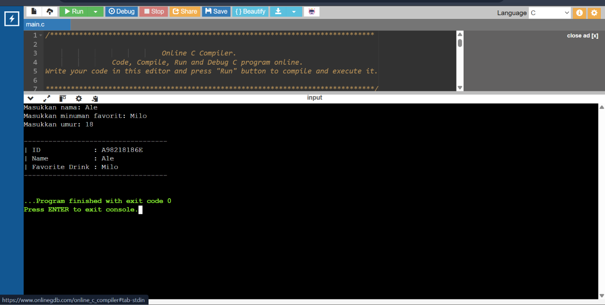

# Foodie Special ID Generator

Program C sederhana untuk menghasilkan ID unik berdasarkan tiga data yang dimasukkan pengguna: **nama**, **minuman favorit**, dan **umur**. ID yang dihasilkan selalu berupa kombinasi huruf dan angka sepanjang minimal 10 karakter.

## Cara Kerja Program

Program membaca tiga input dari terminal menggunakan `scanf()`, yaitu:
1. Nama pemilik ID
2. Minuman favorit
3. Umur

Dari ketiga data tersebut, program menyusun ID dengan rumus berikut:

```
ID = [Inisial Nama] + [1000 - Umur] + [Umur] + [ASCII besar + ASCII kecil dari inisial minuman] + [Huruf terakhir nama, dibuat kapital]
```

### Penjelasan tiap bagian

- **Inisial Nama** — huruf pertama dari nama yang diketik (misalnya "Ale" → `A`).
- **1000 - Umur** — angka yang membuat ID tetap panjang meskipun umurnya kecil.
- **Umur** — dipakai apa adanya sesuai input.
- **ASCII besar + ASCII kecil dari inisial minuman** — huruf pertama minuman diubah jadi versi kapital dan versi kecil, lalu nilai ASCII keduanya dijumlahkan. Contoh: minuman "Milo" → huruf pertama `M`/`m` → 77 + 109 = `186`.
- **Huruf terakhir nama (kapital)** — huruf terakhir dari nama, diubah jadi huruf besar. Contoh: "Ale" → huruf terakhir `e` → `E`.

### Contoh

Input:
- Nama: `Ale`
- Minuman favorit: `Milo`
- Umur: `18`

Hasil ID: **`A98218186E`**

Rinciannya: `A` (inisial) + `982` (1000-18) + `18` (umur) + `186` (ASCII M+m) + `E` (huruf akhir kapital).

## Cara Program Memenuhi Ketentuan Soal

- **Minimal 3 input terminal** → nama, minuman favorit, dan umur semuanya dibaca lewat `scanf()`, tidak ada yang ditulis langsung di dalam kode.
- **Minimal 10 karakter, kombinasi huruf-angka** → ID akhir selalu terdiri dari huruf dan angka, dan panjangnya minimal 10 karakter.
- **Konkatenasi pakai `sprintf()`, minimal 2 operasi** → program memanggil `sprintf()` sebanyak tiga kali:
  1. Menggabungkan inisial nama, selisih umur, dan umur menjadi `bagian1`.
  2. Menggabungkan jumlah ASCII minuman dan huruf akhir nama menjadi `bagian2`.
  3. Menggabungkan `bagian1` dan `bagian2` menjadi ID akhir.
- **Tidak memakai library selain `stdio.h`** → program tidak memakai `string.h` maupun `ctype.h`. Panjang nama dicari secara manual dengan perulangan `while` sampai menemukan karakter `'\0'`, dan konversi huruf besar/kecil dilakukan manual dengan aritmetika ASCII (menambah atau mengurangi 32), bukan dengan `strlen()` atau `toupper()`.

## Cara Menjalankan Program

1. Compile program dengan GCC atau Code::Blocks, misalnya:
   ```
   gcc foodie_id.c -o foodie_id
   ```
2. Jalankan hasil compile-nya:
   ```
   ./foodie_id
   ```
3. Masukkan data saat diminta, contoh:
   ```
   Masukkan nama: Ale
   Masukkan minuman favorit: Milo
   Masukkan umur: 18
   ```
4. Program akan menampilkan ID beserta data yang sudah dimasukkan.

## Contoh Output Program

```
-----------------------------------
| ID             : A98218186E
| Name           : Ale
| Favorite Drink : Milo
-----------------------------------
```


